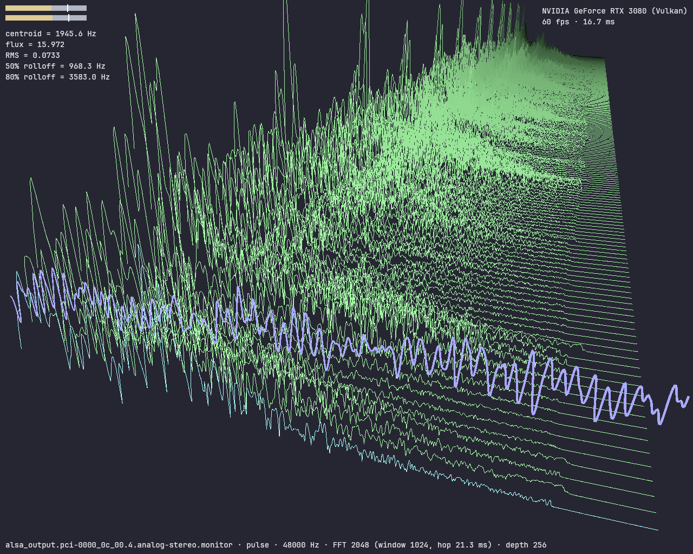

# neopeek

**Disclaimer: this project was written by agents for fun and was only tested in a pipewire+vulkan+wayland environment—I have not read most of the code, so no guarantees about functionality or code quality**

A modern, reimplementation of [sndpeek](https://soundlab.cs.princeton.edu/software/sndpeek/) with support for modern linux audio stacks.



This reimplementation was done as a "clean room" to avoid importing historical technical debt or design idiosyncrasies, but since the agents were not restricted from accessing the source code of the original project (GPL2 or later) I've decided to license it under GPL3 to be safe.

## Build & run

```sh
nix build .#          # release binary → ./result/bin/neopeek
nix run .#            # run directly (wrapProgram handles Vulkan/GL loader paths)
nix develop .#        # dev shell (cargo, clippy, libpulse, alsa, vulkan-loader)
```

Plain `cargo build` works too when `libpulse`/`alsa-lib` are linkable in the
environment; under NixOS use the dev shell (`nix develop .# --command cargo …`).

Runtime needs: a Vulkan (or GL) driver and a PulseAudio-compatible capture
server — PipeWire hosts work transparently via `pipewire-pulse`.

## Controls

Mouse: left-drag orbit · shift-/middle-drag pan · wheel zoom.

| key | action |
|-----|--------|
| `1` / `2` / `3` (or `w`) | waveform / Lissajous / waterfall toggle — the Lissajous figure is drawn **coplanar with the waveform** (same x-y plane, lower-right of the scene: right of center, below the wave strip) so it faces the default camera instead of standing edge-on |
| `S` | filled-surface waterfall mode: theme `surface_ramp` colors — **unless rainbow (`r`) is also on**, in which case the same height heatmap colors the surface (no depth dimming); the arriving plane keeps the theme now/future blend either way. Non-rainbow depth dimming keeps a floor: even the oldest slice stays at ≥ 35 % of its ramp color so the surface never fades fully into the background (line mode keeps the original full fade) |
| `d` | dB magnitude mode (theme `db_floor`/`db_ceil` window) |
| `r` | rainbow = **height heatmap**: color follows the curve's magnitude at each point — cool violet/blue at the floor, cyan/green mid, yellow → red at the crest (same mapping in linear and dB display modes; no depth dimming while on) |
| `a` | auto-scale waterfall gain — sizes the waterfall height to the audio content each frame (tallest recent content ≈ 8/10 of the view; fast attack, slow release ≈ 1.4 s; silence holds the last gain). Off → the fixed default height returns immediately. |
| `u` / `i` | slice z-spacing wider/narrower |
| `j` / `k` | waterfall z-offset toward/away |
| `PageUp` / `PageDown` | waterfall history layers (depth), 8…256 — also set at startup with `--depth <n>` (default 48) |
| `o` / `n` | FFT size up/down one rung on the 512 → 1024 → 2048 → 4096 → 8192 ladder (default 2048, also set at startup with `--fft <size>`); the waterfall rebuilds instantly, feature smoothing restarts on the new bin geometry |
| `c` / `v` | waterfall frequency-axis log factor ×1.15 / ×0.87 (`v` flattens toward linear) |
| `-` / `=` | spectrum frequency axis ×0.99 / ×1.01 |
| `_` / `+` | waveform vertical scale |
| `l` / `L` | Lissajous figure scale |
| `<` / `>` | waveform/Lissajous strip width (world-space quads) |
| `y` | pseudo-Lissajous delay (mono-ish sources): 512 → 256 → 128 → 64 → 512 samples. **Note:** `Y` is the snap-side camera view, not this. |
| `[` / `]` | camera tilt steps |
| `f` (or `z`) | freeze — stop ingesting frames, keep rendering |
| `m` | mute — also stops frame ingestion (listener-only build) |
| `h` | keybind-hint line toggle |
| `H` | whole HUD toggle |
| `T` | cycle themes (Ember → Ice → Terminal → Cyber → TTY → loaded custom) |
| `F` | camera reset/fit |
| `X` / `Y` / `Z` | snap views: top / side / front |
| `p` | print all live settings to the console (sndpeek parity) |
| `q` / `Esc` | quit |

The waterfall's default height (`views::DEFAULT_WATERFALL_GAIN = 0.35`, linear mode) is
**tuned down from sndpeek's `gain = 1.0`**: with raw FFT magnitudes, gain 1.0 flings a
typical frame (max `|X| ≈ 0.3` → y ≈ 4.9) several times past the top of the default view;
0.35 maps the same content to y ≈ 1.7 — ≈ 0.86 of the front-slice frustum height at the
default vantage. `-`/`=` zoom *relative* to it, and `a` (auto-scale) replaces it with a
content-adaptive gain.

**FFT size vs. resolution, honestly:** the analysis window is *fixed* at 1024 samples
(≈ 21.3 ms @48 kHz) — that alone determines the true frequency resolution (≈ 47 Hz per
independent bin, regardless of the FFT size). `o`/`n` change the zero-padded transform
length: a larger FFT interpolates that same window into more bins (finer display
granularity — narrower peaks on the axis, smoother rolloff readouts), while 512 analyzes
only the newest 512 samples of each window (coarser but snappier readouts). Only the
window length would change the real resolution.

The HUD: left = L/R RMS meters with 800 ms peak-hold ticks + feature panel
(spectral centroid in Hz, flux, RMS, 50%/80% rolloff); right = fps, frame ms,
GPU adapter; bottom = device, backend, rate, FFT/window/hop, history depth,
keybind hints; center = frozen/muted overlays.

## Themes

RON files: background, waterfall colors (`past`/`future`/
`now_line`, optional `rainbow`, dB window, optional `surface_ramp` stops),
waveform/lissajous color+scale, meter gradient + peak hold, HUD text colors
and font size. Example — see `crates/neopeek-theme/assets/themes/Ember.ron`.
`surface_ramp` stops run dark (low magnitude) → bright (peak); themes
without one fall back to a two-stop `past → future` gradient. The built-ins
all ship high-contrast ramps (large luminance swing from the background up
to a near-white tip) because the filled surface must stay legible without
the rainbow heatmap.

```ron
(
    name: "Ember",
    background: "#050508",
    waterfall: ( past: "#66ff66", future: "#ffb366", now_line: "#66ffff",
                 rainbow: false, db_floor: -80.0, db_ceil: 0.0 ),
    waveform: ( color: "#6666ff", width: 1.0 ),
    lissajous: ( color: "#ffff80", scale: 0.45 ),
    meters: ( grad_low: "#59ff4d", grad_high: "#ff4d4d", peak_hold_ms: 800 ),
    hud: ( text: "#e6e9ef", dim: "#8a93a5", font_size: 14.0, accent: "#e2542a" ),
)
```

Colors are `#rgb`, `#rrggbb` or `#rrggbbaa`.

Built-ins: **Ember** (default; pleasant mid-contrast dark theme), **Ice** (blue/cyan),
**Terminal** (high-contrast phosphor-CRT hacker green), **Cyber** (bright-pink
waterfall, electric-yellow Lissajous), **TTY** (pure-black background, classic
VGA 16-color console palette).

`--theme <name|path>`: an existing `.ron` path loads that file; otherwise
`$XDG_CONFIG_HOME/neopeek/themes/<name>.ron` is tried; otherwise a built-in
name; otherwise a warning is logged and Ember is used. A malformed or missing
file never crashes the app. `T` cycles the built-ins plus a loaded custom
theme; `--watch-theme` re-parses the loaded file on every change (dev aid,
off by default).

## Audio

- Backend: PulseAudio protocol (`--backend pulse`, the default and only
  backend for now) — covers PipeWire hosts via `pipewire-pulse`. An ALSA
  fallback (`cpal`) is planned.
- `--list-devices`: enumerate sources (mics + sink monitors, `monitor`
  flagged).
- `--device <name>`: record from a specific source; default is the default
  sink's monitor ("what the host hears").
- `--dump-pcm [seconds]` / `--dump-fft [seconds]`: stdout dumps of raw
  interleaved f32 PCM / verbose per-slice features (capture must be
  available). Both run the FFT pipeline at the `--fft` size.
- `--print [seconds]`: sndpeek parity — one space-separated line per
  FFT slice: `centroid_hz flux rms ro50_hz ro80_hz` (plain floats;
  no MFCC). Shares the capture+FFT path with `--dump-fft`, which prints
  the more verbose debug format instead.
- `--fft <size>`: FFT length (512…8192, power-of-two ladder, default
  2048); the `o`/`n` keys adjust the same setting at runtime. The
  analysis window is fixed at 1024 frames and zero-padded to the FFT
  size (512 analyzes the newest 512 samples of the window instead).
- The negotiated sample spec (rate/format/channels) is returned by the
  capture handshake and refused if not f32 stereo; the DSP window is 1024
  frames (≈21.3 ms @48 kHz) zero-padded to the FFT size (default 2048 →
  1024 bins; runtime-adjustable 512…8192 via `--fft` / `o` / `n`).

## Architecture

Workspace crates:

- `neopeek-audio` — PulseAudio capture, PCM SPSC ring, device listing
- `neopeek-dsp` — windowing + FFT engine, fixed-size POD `Frame` (bins,
  mono, L/R, RMS/peak, spectral features)
- `neopeek-render` — wgpu pipelines (waterfall line + filled-surface,
  waveform/Lissajous quad strips, glyphon HUD), camera, frame ring
- `neopeek-theme` — RON theme model, built-ins, `--theme` resolution,
  hot-reload watcher
- `neopeek-config` — CLI surface
- `neopeek` — winit app shell, input mapping, HUD assembly, DSP thread

Hot paths (capture → DSP → frame-drain) are allocation-free with fixed-size
POD `Frame`s and a lock-free SPSC ring; drop-oldest at the consumer. The HUD
assembly allocates small per-frame strings for text shaping (render-side
only). The active `Theme` is copied once per redraw (a handful of short
strings — negligible, and it keeps borrows disjoint).

## License

GPL-3.0-only. The bundled JetBrains Mono font
(`crates/neopeek-render/assets/fonts/`) is under the SIL Open Font License
1.1 (`JetBrainsMono-OFL.txt` alongside it).
